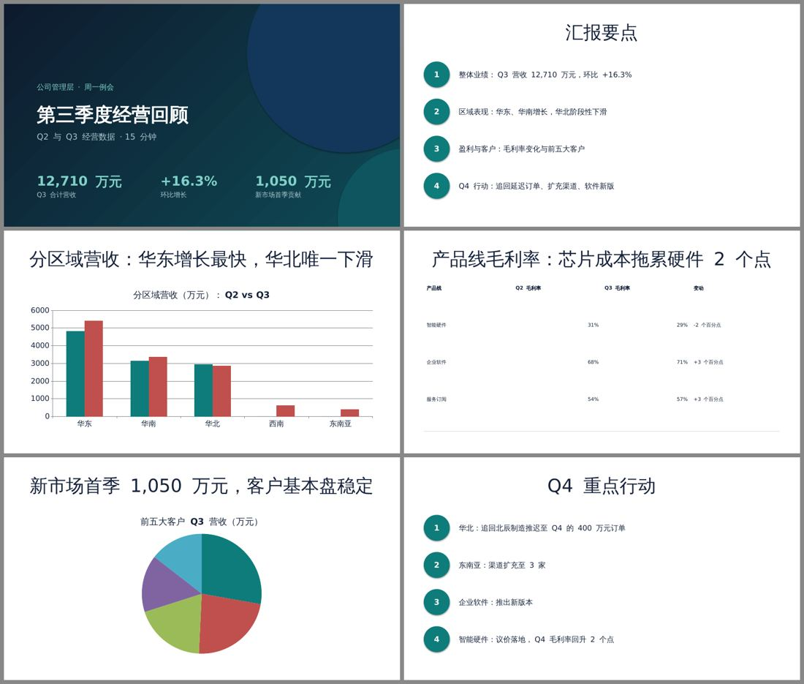
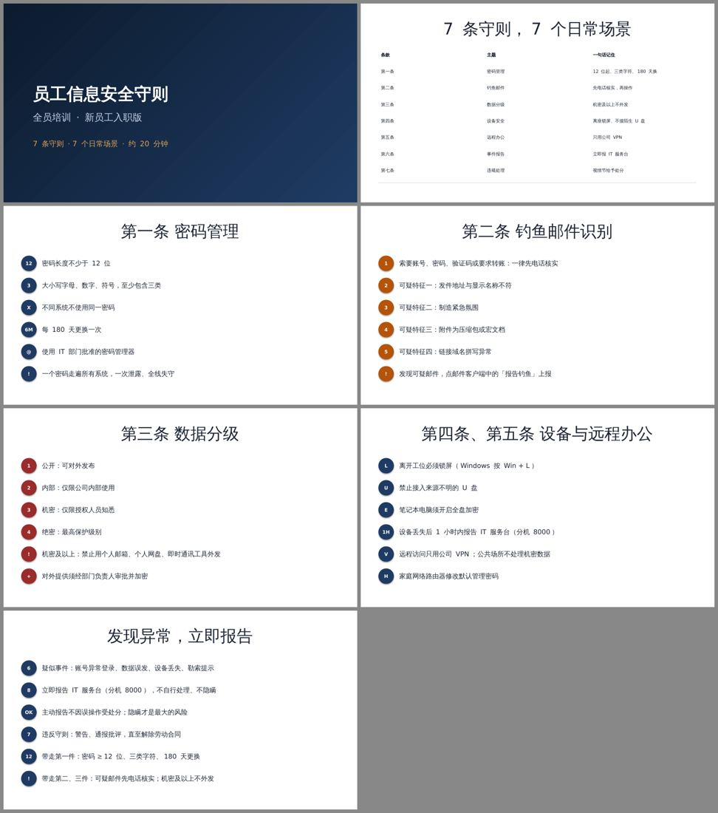
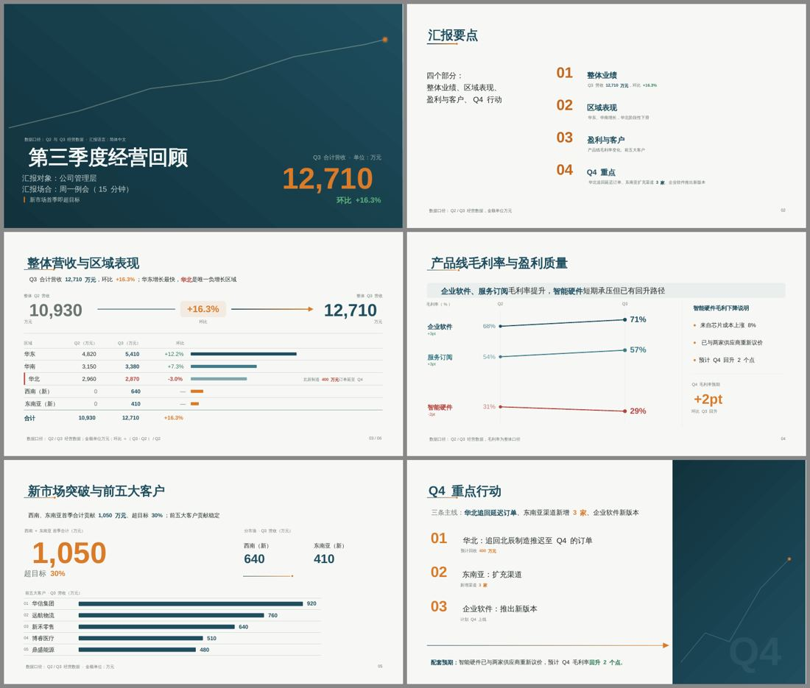
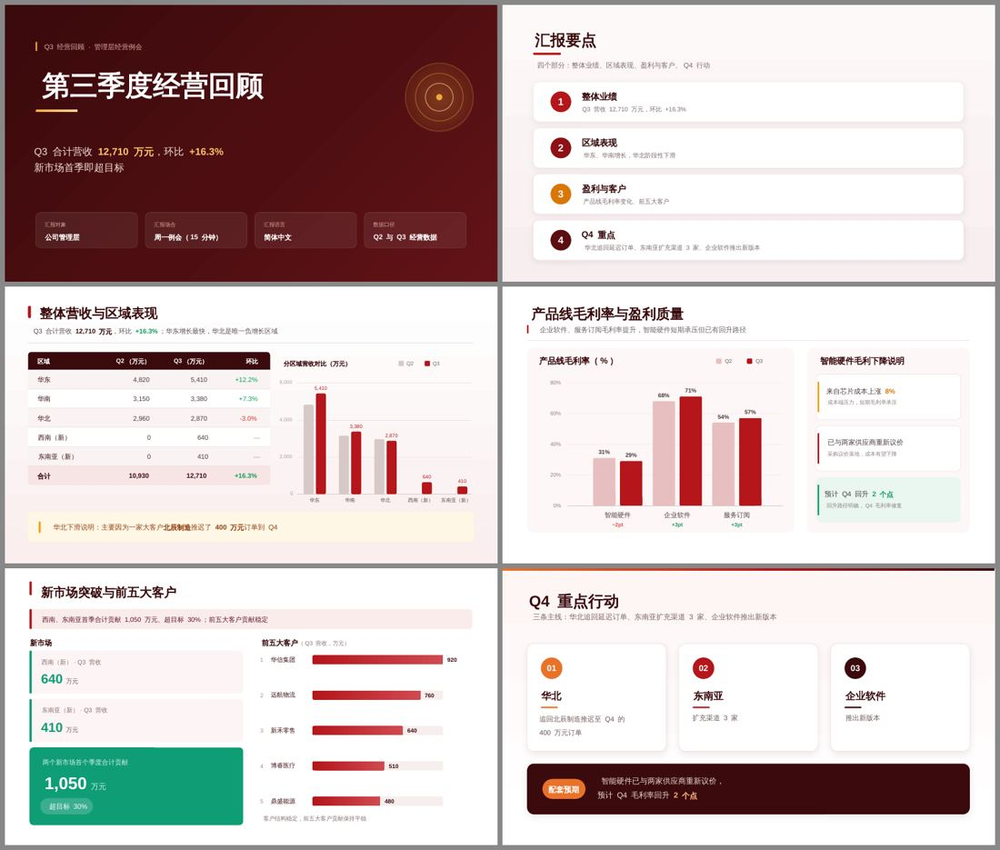

# The route for Word, Excel and PowerPoint: research and measurements

Date: 2026-10-13. Author: the maintainer's planning session. Question from the maintainer: is
coscribe's way of producing office files the right one, given that `hugohe3/ppt-master` (an MIT
project, 61.5k stars) makes visibly better decks at the same price? The direction the maintainer
set: coscribe does not compete with specialist projects on every generation engine; it is a good
host, reuses open-source code where the licence allows ("what we need not write, we do not
write"), and writes the rest itself. PowerPoint first, then Excel, then Word.

Everything below was run, not read: ppt-master was cloned (commit `bf89859`, 2026-10-13) into a
scratch directory and used only as an instrument; no file of it is in this repository.

## 中文摘要

1. **差距来自"媒介"，不是提示词，也不是 ppt-master 那 857 KB 的流程和参考文档。** 同一份内容大纲、同一个模型
   （deepseek-flash）：让模型把每一页写成一个完整的 SVG，只给约 2,000 字的技术约束，6 页季度汇报 78 秒、
   约 ¥0.2，两位盲评打的设计分 4.0–4.9（满分 5）；我们现在的写法（`write_pptx` + `add_pptx_chart`）同样内容 2.1–2.4 分，
   表格错位、饼图无标签。加设计参考、先写设计规格、检查器修复轮，提升都在两次运行之间的随机波动以内。
2. **成本几乎全在模型的"思考"输出上**（96%），不是缓存。推理强度 low 与默认 high 的盲评分在误差内，简单写法省约 35%；
   关闭思考（none）每套只要 ¥0.07，但会出现看不见的白字、文字出界、编造年份，必须靠检查器兜住。
3. **基于页面源码的修改又准又便宜**：改一个数字（同步合计、环比、柱高）17 秒，3 页改对、3 页不动；
   整套换品牌色 37 秒。我们现有的编辑工具对这种 PPT 几乎改不了（只认占位符和顶层序号），
   `list_pptx_shapes` 遇到分组直接崩溃（已开 #135）。
4. **ppt-master 能复用的部分已经验证**：它的"SVG 元素 → PowerPoint 形状"核心是 37 个模块、约 2.4 万行，
   不含它的署名校验，可以整体复制进来当作我们自己的代码（MIT，保留版权声明）；我写了约 150 行的遍历和打包，
   转出来的页面与 ppt-master 自己导出的几乎一样。编排、检查器、工具接口由我们自己写。
5. **建议路线**：新建 PPT 用"整页 SVG → 编译 → 检查 → 修复"；修改走"页面源码"和"升级后的对象级工具"两条路；
   动画、模板、XML 直改保留并加强。Excel、Word 用同一原则（整份一次写出 + 确定性编译 + 检查 + 基于源码修改），
   但媒介不同，到各自阶段再实测。具体分期和规模见第 7 节，决策记录草稿见 `docs/decisions/0010`。

## 1. Method

- Two briefs written for this test, both Chinese, realistic: **T1** a 6-page Q3 business review for
  management from three tables and four notes (numbers, regions, margins, customers); **T2** a
  7-page all-staff security training deck from a 7-article policy text.
- One content outline per brief (a model call, then frozen), so every condition below shows the
  same facts; only the way pages are made differs.
- Conditions, all with `deepseek-flash` (DeepSeek-V4.1-Flash, checked on `/models` 2026-10-13):
  - **E**, coscribe today: the built-in pptx skill and the docstrings of `write_pptx` and
    `add_pptx_chart`; the model returns the calls, which run through coscribe's real tools. One shot
    (the full agent loop was measured in `PPTX_DESIGN.md` §38: same gap, 687 s).
  - **A**: the model writes each page as one SVG under a ~2,000-character technical contract
    (canvas, allowed elements, text lines as `tspan`, groups with bounds); pages in parallel.
  - **B**: A plus ~25k characters of design guidance (ppt-master's executor "Page Expression Core"
    and shared aesthetic baseline, read as-is).
  - **C**: B plus a design spec written first (palette, type scale, grid, per-page structure) and
    given to every page.
  - **D**: C plus one repair round driven by ppt-master's quality checker (overflow, overlap,
    contrast warnings as well as errors).
  - Every condition must compile: pages whose SVG the converter rejects get up to two repair rounds
    fed with the checker's errors only.
  - **A2, B2**: A and B again (run-to-run variance). **AL, BL / AN, BN**: A and B with DeepSeek's
    `reasoning_effort` set to `low` / `none` (default is `high`; parameter checked in DeepSeek's API
    docs and by its effect on reasoning tokens).
- Conversion and checking: ppt-master's own exporter and checker, unmodified, in a scratch venv.
  Rendering: LibreOffice to PDF, `pdftoppm` to PNG.
- Judges: Gemini 3.5 Flash (3.1 Pro had no quota on this key, 3.7/3.8 Flash answered 503, and the
  free tier's 20 requests a day ran out after one round) and deepseek-flash with image input (also
  the generator, so it may favour its own style, but every condition is its own; it saw the pages
  at reduced resolution, ~280 tokens a page). Blind (decks relabelled at random), all decks of one
  brief in one request, PPTEval's three
  dimensions (design, content, coherence; 1–5) plus the three worst defects per deck and a ranking.
  PPTEval reports a judge–human correlation of 0.90 for design, 0.70 content, 0.55 coherence
  (arXiv 2501.03936). Each set was judged several times with different relabelling.
- I also looked at every deck myself (contact sheets) and wrote down defects.

## 2. Findings

### 2.1 The medium is the lever

| T1, 6 pages | Time | Calls | Output tokens | Cost (off-peak) | Judge design: Gemini (1 round) / DeepSeek (mean of 3) |
|---|---|---|---|---|---|
| E (coscribe today) | 81 s | 1 | 15k | ¥0.06 | 2.1 / 2.27 |
| A (SVG pages, 2k-char contract) | 78 s | 6 | 50k | ¥0.20 | 4.3 / 4.00 (its repeat A2: 4.9 / 4.27) |

E's defects (seen, and named by the judge): the margins table is shifted by one column, the pie
chart has no labels, every list page looks the same, Q3 bars are red for growth. A's pages have
KPI cards, a table next to a bar chart, a takeaway band, an explanation callout, consistent type.
T2 shows the same gap (E: seven numbered-icon list pages with centred titles; A: varied
structures per article). The model and the facts are the same; what changed is that the model
composes one whole page at once in a medium it knows well (SVG), instead of ~50 incremental tool
calls against prefab layouts. This confirms `PPTX_DESIGN.md` §38 with a controlled comparison.

T1, coscribe today (E) and the same content as SVG pages (A); T2, E and B:

### 2.2 Design guidance, a spec, a checker loop: small gains, inside the noise

Design score (1–5), blind; T1 judged once by Gemini and three times by DeepSeek, T2 three times by
DeepSeek (Gemini's free quota, 20 requests a day per model, ran out); mean rank among the 7 decks:

| Condition | T1 Gemini | T1 DeepSeek | T2 DeepSeek | Mean rank T1 / T2 |
|---|---|---|---|---|
| A (contract only) | 4.3 | 4.00 | 4.23 | 5.2 / 2.7 |
| A2 (A again) | 4.9 | 4.27 | 4.10 | 3.0 / 4.0 |
| B (+ design guidance) | 4.7 | 4.07 | 4.50 | 4.2 / 1.0 |
| B2 (B again) | 4.8 | 4.43 | 4.13 | 2.2 / 4.0 |
| C (+ design spec) | 4.6 | 4.23 | 3.97 | 3.5 / 4.7 |
| D (+ checker repair round) | 3.2 | 4.53 | 4.00 | 2.8 / 4.7 |
| E (coscribe today) | 2.1 | 2.27 | 2.37 | 7.0 / 7.0 |

The same deck judged again moves by ±0.1–0.25.

Read with care: the same condition run twice (A vs A2, B vs B2) differs as much as the
conditions differ from each other, and a Flash judge is itself noisy (several relabelled rounds
are averaged above). What is solid:
- every SVG condition is far above E;
- the design spec (C) gives the most consistent decks (running footer, page numbers, one motif)
  and smarter chart choices (a slope chart for margins), at 2–3x the time; it also invented facts
  ("Q3 · 2024", "版本 v1.0", ".zip/.rar") and once put "02" on page 4;
- the warnings-repair round (D) made pages calmer but emptier: Gemini marked it down for dead space
  (3.2), DeepSeek ranked it first on T1 and in the middle on T2; to my eye it was the most
  editorial deck. It costs 4–5 minutes.

So the design guidance and the spec are worth having, but they are refinements; the order of work
is the medium first, then a small set of design rules, then a spec for long decks.

### 2.3 Cost is the model's thinking, and `none` breaks pages

The maintainer saw ¥5.7 for 2.04M tokens. All runs together: 659k input (473k cached, ¥0.20) and
1,366k output (¥5.47): **96% of the cost is output**, and most output is reasoning: T1-A's six
pages are 28 KB of SVG (~10k tokens) against 50k output tokens.

| Per deck | high (default) | low | none |
|---|---|---|---|
| A, T1 / T2 | ¥0.20–0.24 / ¥0.33–0.35 | ¥0.14 / ¥0.20 | ¥0.07 / ¥0.07 |
| B, T1 / T2 | ¥0.27–0.36 / ¥0.45–0.55 | ¥0.32 / ¥0.35 | ¥0.12 / ¥0.12 |
| Time | 78–176 s | 54–154 s | 28–37 s |

Judged as a separate set of 8 decks per brief (DeepSeek, three rounds, design score):

| | T1 | T2 |
|---|---|---|
| A, high (A, A2) | 4.30, 4.50 | 4.40, 4.20 |
| A, low (AL) | 4.17 | 4.33 |
| A, none (AN) | 3.67 | 3.47 |
| B, high (B, B2) | 4.20, 4.20 | 4.23, 4.13 |
| B, low (BL) | 4.23 | 4.03 |
| B, none (BN) | 2.90 | 3.93 |

`none` is three times cheaper and four times faster, but pages broke in ways the checker did not
stop: T1-BN's cover title and hero number were white on white, it invented "2026 财年", bar labels
were clipped; T2-AN had text below the slide and a title over its header band. `low` looked as
good as `high`, was judged level with it, and saved about 35% for A (not for B).

### 2.4 Editing through the page source is accurate and cheap

The SVG pages of T1-A were kept. Each page was offered an edit request and answered either
`UNCHANGED` or a full new SVG, then the deck was re-exported:

| Request | Time | Pages changed | Result |
|---|---|---|---|
| East China Q3 5,410 → 5,600, keep everything consistent | 17 s | 3 of 6 | total 12,900, growth +18.0%, East +16.2%, bar 262 → 271 px (= 262 × 5600/5410), all right; 3 pages untouched |
| Recolour the deck to the brand red #B4161B, dark #3A0A0C | 37 s | 6 of 6 | consistent; one green highlight card left green |

### 2.5 coscribe's editing tools cannot edit such decks

On the T1-A deck: `read_pptx` reads the text (it walks groups since 8ci) but every slide title is
empty, because the converter writes text boxes, not a title placeholder; `list_pptx_shapes`
crashes on any group shape (`TypeError` from `GroupShape.click_action`, issue #135);
`edit_pptx_text` edits placeholders only; `edit_pptx_shape`, `add_pptx_animation` and
`delete_pptx_shape` address top-level shapes by index, so nothing inside a group can be reached.
The SVG group ids do survive as shape names (`header`, `table`, `chart`, `note`), which is what a
better addressing scheme can use.

### 2.6 What of ppt-master can be reused

ppt-master is 197k lines of Python (converter 56.7k, PPTX→SVG 20.8k, checker 12k, tests 14.6k),
64 MB of templates (icons 49 MB) and 0.4 MB of workflow text, MIT. Its scripts check their own
attribution (SKILL.md metadata, LICENSE text, SPONSORS) at every entry point; the MIT licence itself
asks only for the copyright notice.

Coupling, by static import closure:

| Entry | Modules | Lines | Pulls the attribution check |
|---|---|---|---|
| exporter CLI | 121 | 106k | yes |
| slide converter (`convert_svg_to_slide_shapes`) | 74 | 60k | yes |
| quality checker | 86 | 81k | yes |
| **element emitter (`convert_rect`, `convert_text`, …) incl. lazy imports** | **37** | **24k** | **no** |
| PPTX→SVG slide lifter | 52 | 37k | no |
| emitter + lifter together | 58 | 44k | no |

Spike: the element emitter's 37 modules copied unmodified, plus ~150 lines written here (tree
walk, groups named by their SVG id, background promotion, packaging with python-pptx). On T1-A's
pages the result renders nearly identical to ppt-master's own exporter; the one gap seen is that
positioned `tspan` line breaks were joined into one line (the cover subtitle, page 6's card text),
which is orchestration the converter does around the emitter. Not tried yet: rotate/scale/matrix
transforms, gradient backgrounds, native charts/tables, images, hyperlinks.

The checker and the full converter are one web with the project system around them; they are
references, not code to copy. Font metrics for text measurement (`font_metrics.json`) come from
Office for Mac fonts; ours should be measured on Windows, our only platform.

Earlier copies from the same project already in coscribe: the LaTeX→OMML formula compiler
(`tools/_native_formula/`, five self-contained files) and the animation presets data.

### 2.7 Other routes (checked 2026-10-13)

| Project | Licence | How new decks are made | Notes |
|---|---|---|---|
| Anthropic pptx skill | proprietary (source-available) | a pptxgenjs script per deck; edits by unzipping and editing XML; QA by render + inspect | ideas only, no copying |
| PPTAgent / DeepPresenter (ACL 2026) | MIT, 5.1k | template mode edits reference slides; free mode writes HTML pages, a Node `html2pptx` (pptxgenjs + Playwright) converts | PPTEval comes from here |
| Presenton | Apache-2.0, 11.1k | HTML/Tailwind templates, the model fills fields | export method not documented |
| GenOffice (Genspark) | Apache-2.0, 9.5k | per deck a style sheet, an outline and one JSON page spec per slide; `slides check` for overflow/overlap | DOCX engine splices changed blocks back byte-for-byte |
| OfficeCLI | Apache-2.0, 31.9k | .NET single binary, path addressing (`/slide[1]/shape[2]`), raw-XML fallback, render loop; 350+ Excel functions, pivot tables | a binary, not code we can own in Python |

SVG vs HTML as the page language: HTML is what models know best and a browser measures text
exactly, but converting needs Chromium and Node and maps CSS to DrawingML with losses; SVG shares
DrawingML's absolute-coordinate model and converts in pure Python, which fits a Windows desktop
app. SVG it is, with text measurement done by us.

## 3. Recommended architecture for PowerPoint

One deck = a folder of page sources (SVG, our documented subset) plus a deck spec, compiled into
the .pptx; the .pptx stays the user's file.

1. **Page language**: a written contract (what the 2k-character prompt of condition A says, made
   exact): canvas, allowed elements, text lines, groups with `id` and bounds, roles (`title`,
   `footer`, `chart`, `table`), forbidden features.
2. **Compiler**: the element emitter copied from ppt-master as our own code (37 modules, MIT
   notice, a fixed snapshot updated only on purpose, excluded from our size metrics like the other
   copied code), plus our orchestration: tree walk, transforms, text flow, background, title into
   the layout's title placeholder (so outline view, accessibility and `edit_pptx_text` work),
   python-pptx packaging, theme colours.
3. **Checker (ours)**: well-formed XML and allowed features (compile errors), group bounds and
   overlap, text overflow measured with Windows font metrics, contrast of text on its fill, nothing
   outside the canvas, and **fact fidelity** (every number and name on a page appears in the
   sources). Errors go back to the model, at most two rounds.
4. **Design knowledge**: a short guide of our own (a few thousand characters: layout structures by
   content relationship, the device menu, colour proportion, type scale, avoid list), condensed
   from ppt-master's text with credit and from our pptx skill. A design spec step for decks over
   about 8 pages.
5. **Model settings**: `reasoning_effort: low` for page writing (2.3: judged level with `high`, up to
   35% cheaper); never `none` without the contrast and canvas checks.
6. **Editing, three paths**: (a) **page source**: any content or design change rewrites the
   affected pages' SVG and recompiles them (2.4); (b) **object tools**, upgraded: addressing by
   shape name and group path, text edits inside any frame, the #135 fix; needed for decks the user
   brings or changed in PowerPoint (a hash per slide tells whether the source is still current);
   (c) **XML** (`read_pptx_xml`/`edit_pptx_xml`, exist). Animations and transitions keep using the
   existing tools, targeting the group names the compiler writes.
7. **Later**: native charts and tables from a data payload (editable data in PowerPoint), the
   user's own template (pages built on its layouts and placeholders), lifting an existing slide to
   SVG for a redesign (the PPTX→SVG lifter, another ~20k copied lines, only if needed).

Tool surface (decision 0001: the tool list is fixed and cached): two new tools at most, e.g. one
that builds or rebuilds pages from SVG sources and one that reads a page's source; everything else
reuses existing tools. The exact names and schemas are part of the first PR and change
`tests/tool_schemas.txt`.

## 4. What happens to `tools/presentations.py`

Rough split of its 7,092 lines by function name: editing ~1,360, animation/transition/audio ~840,
QA ~420, read/XML ~380, templates ~310, generation (`write_pptx`, prefab layouts, theme) ~760 plus
`_svg_slide.py` 737, helpers ~2,000. Most of the file stays and is improved; only the generation
part is replaced, and `write_pptx` can stay as the plain path until the engine has proven itself
in the evaluation. The split of this file (structure-period step 11) should follow this boundary:
`tools/office/pptx/` with `engine/` (compile, check), `edit/`, `motion/`, `qa/`, `xml/`,
`templates/`.

## 5. Excel and Word

Same principle, different media; to be measured in their own phases:
- **Excel**: the workbook is data and formulas. A whole-workbook spec (or a short openpyxl script)
  written in one pass, compiled, recalculated (LibreOffice, as `write_xlsx` does today), checked for
  formula errors and for formulas instead of pasted numbers, with formatting conventions applied by
  code. Today's tools write one sheet per call and format through many small tools. OfficeCLI's
  formula engine is .NET; our Python evaluators (`tools/_xlsx_lookup_formulas.py`) stay.
- **Word**: flowing text, Word paginates. A semantic document spec (headings, paragraphs with runs,
  tables, figures, callouts, captions) compiled onto a style system (real Word styles so the user
  can keep editing), checked by rendering (empty pages, table overflow, widows), and edits that
  rewrite only the changed blocks (GenOffice's byte-preserving splice is the idea to copy).
  Today's `write_docx` is a markdown subset; tracked changes and comments already exist.

## 6. Evaluation (to build first, in the repository)

- ~10 PowerPoint tasks from real office work: data review, policy→training, project proposal with
  a timeline, product launch with images, a long report summarised, the user's own template, an
  existing deck to edit (numbers, a new page in style, restyle), mixed CJK/English, a dense table,
  a 15-page deck.
- Per deck: compiles on first pass; checker findings; fact fidelity; an editability probe run with
  coscribe's own tools (read titles, change a number, recolour, animate a named group); cost and
  time from usage.
- Judge: blind, at least three relabelled rounds, two judge models where quota allows; a Pro-class
  judge needs a key with quota. Variance in 2.2 shows single runs mislead: two generations per
  condition.
- The maintainer: a blind pairwise look at a sample on Windows PowerPoint (opens without a repair
  prompt, looks professional). LibreOffice rendering is not PowerPoint.

## 7. Plan and size

| Phase | What | New code (ours) | Copied | Gate |
|---|---|---|---|---|
| P0 (now, structure period) | this report, decision 0010, the evaluation harness and tasks in the repo | ~800 (scripts, tasks) | 0 | the maintainer accepts 0010 |
| P1 | PPT engine MVP: page contract, compiler orchestration, checker, design guide, one or two tools; title placeholders | ~1,500–2,500 | ~24k (element emitter) | beats today's route on the evaluation; the maintainer prefers it on Windows |
| P2 | editing: object addressing, #135, page-source edits, slide hashes; native charts/tables; user templates | ~1,500 | 0 | editability probe passes on engine decks and on user decks |
| P3 | Excel, the same way (spec, compile, recalc, check) | measured then | — | evaluation |
| P4 | Word | measured then | — | evaluation |
| later | lift existing slides to SVG | ~500 | ~20k | only if P2 leaves a real gap |

P1 can start before the structure period ends because it lands as new files behind a new tool;
the split of `presentations.py` waits for P1 so it is split once along section 4's boundary.

## 8. Risks

- **24k copied lines**: we own them; a frozen snapshot with its NOTICE, tests on what we use,
  updated deliberately (as with the formula compiler). The attribution check is not copied; the
  MIT notice is kept.
- **Fonts on Windows**: text measurement needs metrics of the fonts PowerPoint will use (Microsoft
  YaHei, DengXian, Arial…); measure them on the maintainer's machine with fontTools.
- **Invented facts**: seen in C and BN; the fidelity check is part of P1, not later.
- **Judge reliability**: Flash judges with run-to-run variance; decisions rest on large gaps (E vs
  SVG), on the maintainer's look, and on repeated runs.
- **Model dependence**: all of this ran on deepseek-flash, the cheap default; other providers need a
  run of the same evaluation.

## Appendix: raw numbers

Scratch results (not in the repository): per condition `result.json` (time, calls, tokens, checker
summary, repairs), contact sheets, judge JSON. All T1/T2 runs: see 2.3. Edit runs: 20k input / 8k
output (numbers), 20k / 22k (recolour). Spike: 41 Python files copied (37 modules + package
`__init__`s), `pptx_shapes/data` 612 KB.
